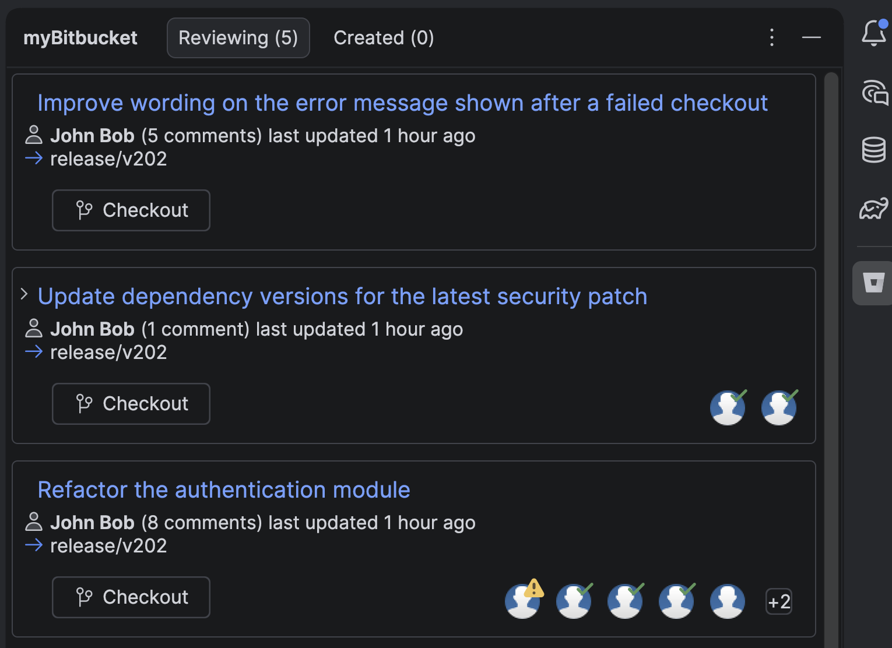

# myBitbucket
[![Downloads][plugin-downloads-svg]][plugin-repo]
[![Version][plugin-version-svg]][plugin-repo]

This plugin for IntelliJ IDEA lets you see, approve and merge your Bitbucket Server or Bitbucket Cloud pull requests without leaving the IDE. It's integrated with Git so you can checkout the corresponding branch straight from a pull request card.

## Configuring the plugin
Open the **myBitbucket** tool window and click **Add Bitbucket repo** (gear icon > **Reconfigure Bitbucket repo…** later on). Paste a link to the repository, or to any pull request in it, into the Repository URL field - project/repo (Server) or workspace/repo (Cloud) are parsed out automatically, and the dialog switches to the matching auth fields.

**Bitbucket Server**: Basic Auth (detected Git credentials, or your own login/password) or an HTTP Access Token - requires Bitbucket Server 5.5+. Generate a token under _Manage account > Account settings > HTTP access tokens_ with **Write** permission for approve/merge.

**Bitbucket Cloud**: OAuth only - click **Sign in with Bitbucket…**.

## Dependencies
Requires “Git Integration” plugin to be enabled to use Git checkout.

## Working with servers that use a self-signed certificate
The plugin performs remote http requests to Bitbucket Server, if your Bitbucket Server uses a self-signed certificate, it needs to be imported into the JetBrains Runtime that Idea ships with (look for a `jbr` folder inside the IDE installation). Use [keytool](https://docs.oracle.com/javase/tutorial/security/toolfilex/rstep1.html) to do that.

## Compatibility
The plugin targets IntelliJ IDEA 2023.3 and newer, and is expected to work with the current version of Bitbucket Cloud or any Bitbucket Server that implements Bitbucket Server REST API 1.0. Was tested using IDEA 2026.2.

## Reporting an issue
If you find any issue, please report it to [GitHub](https://github.com/BigBurritoInc/BitbucketHelper4Idea/issues) or [email us](mailto:bitbucket.plugin@gmail.com)

[plugin-repo]: https://plugins.jetbrains.com/plugin/11577-mybitbucket
[plugin-downloads-svg]: http://img.shields.io/jetbrains/plugin/d/11577
[plugin-version-svg]: https://img.shields.io/jetbrains/plugin/v/11577?label=version
